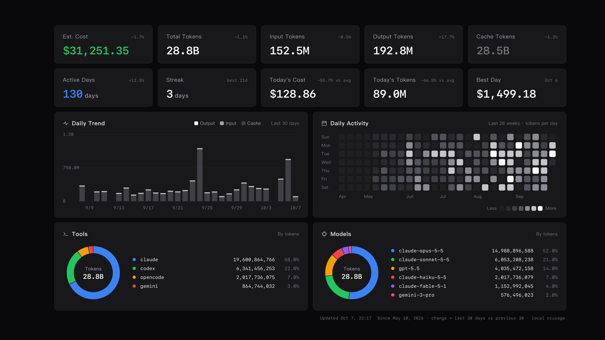
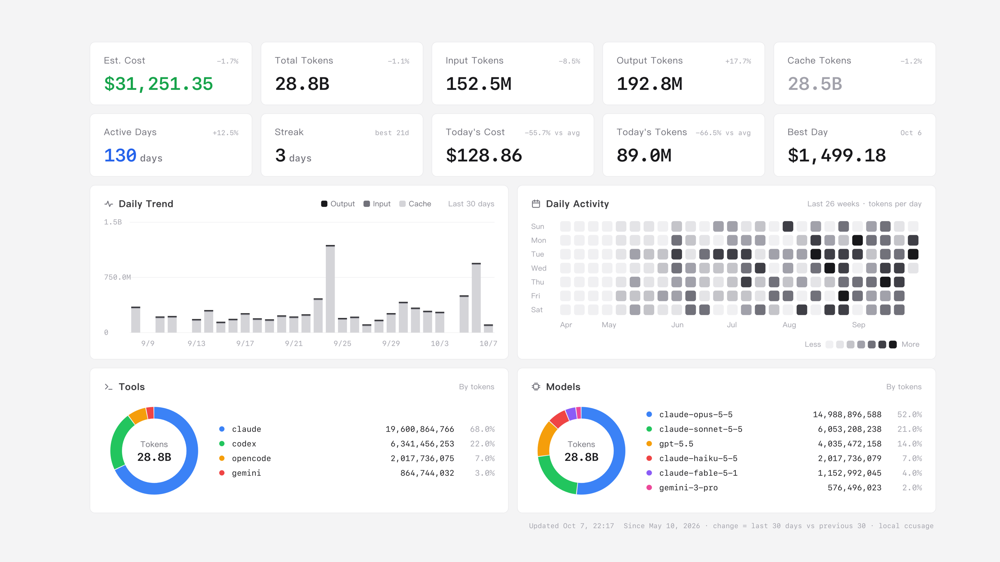

# token-wallpaper

Your AI coding token usage, as a macOS wallpaper that updates itself.



It reads the same local logs as [ccusage](https://github.com/ryoppippi/ccusage) — Claude Code, Codex,
OpenCode, Gemini CLI and the other agents ccusage knows — and draws a dashboard on your desktop every
30 minutes. Dark or light follows your macOS appearance.



*Screenshots use made-up data (`render --demo`).*

## What it shows

- Estimated cost; total, input, output and cache tokens
- Active days, current and longest streak, today's cost and tokens, best day
- Daily tokens for the last 30 days, split into output, input and cache
- A 26-week activity heatmap
- Token share by tool and by model

The small number on each card is the change of the last 30 days against the 30 days before.
On the two "Today" cards it is today against the 30-day daily average.

## Requirements

- macOS (tested on macOS 26 with a Retina and a 5K display)
- Python 3.9 or newer (the one that ships with the Xcode command line tools is fine); no packages
- Node.js, so `npx` can run ccusage
- Google Chrome, or another Chromium browser: Chromium, Microsoft Edge, Brave

## Install

```bash
git clone https://github.com/lycfyi/token-wallpaper.git
cd token-wallpaper
python3 tokenwall.py install
```

`install` writes a LaunchAgent to `~/Library/LaunchAgents/`, runs an update right away, and then
updates every 30 minutes (`--interval SECONDS` to change it).

Then open **System Settings → Wallpaper** and turn on **Show on all Spaces**. macOS only lets a
program change the current Space of each display.

## Commands

```bash
python3 tokenwall.py update                 # collect, render each screen, set the wallpaper
python3 tokenwall.py render --out x.png     # one image; --size 5120x2880 --scale 2 --dark --demo
python3 tokenwall.py import cc.json         # merge an older `ccusage daily --json` report
python3 tokenwall.py uninstall              # remove the LaunchAgent; your history stays
```

| Variable | Use |
|---|---|
| `TOKENWALL_NPX` | path to `npx`, if it is not found on `PATH`, fnm, nvm, Volta or Homebrew |
| `TOKENWALL_BROWSER` | path to a Chromium-family browser executable |
| `TOKENWALL_CCUSAGE` | ccusage package spec, default `ccusage@20.0.26` |

## How it works

1. `npx ccusage daily --json --by-agent` produces a per-day report.
2. The report is merged into `~/Library/Application Support/token-wallpaper/history.json`. A day
   never shrinks there, so your history survives when an agent deletes old session logs
   (Claude Code keeps 30 days by default; raise `cleanupPeriodDays` to keep more).
3. The dashboard is built as an HTML page, laid out at 1600×900 and zoomed into the part of each
   screen that the menu bar and the Dock leave free.
4. Headless Chrome takes a screenshot at each screen's exact pixel size, and the image is set as
   that screen's wallpaper.

If ccusage fails, the wallpaper is drawn from the saved history and the footer says
`not refreshed`. The log is `~/Library/Application Support/token-wallpaper/update.log`.

## Privacy

Everything stays on your Mac. The only network access is `npx` downloading the ccusage package.
Your history and the rendered images are written under `~/Library/Application Support/token-wallpaper/`.

## License

MIT
